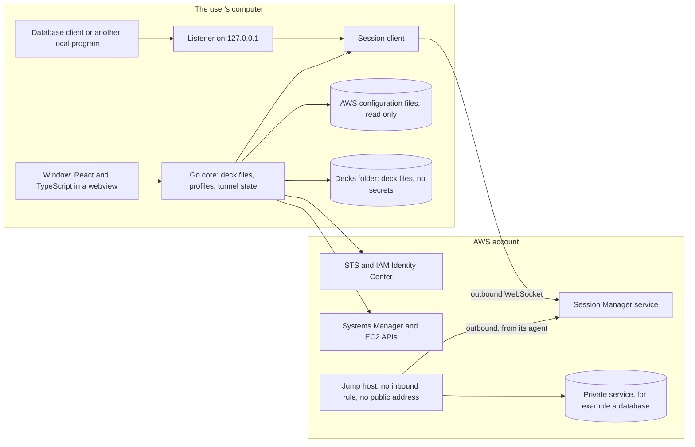

# Clouddecks plan

Clouddecks is a set of small desktop tools for people who work with cloud accounts every
day. Each tool is a deck: one job, one window, one executable, so a person takes only the
deck they need. The first deck is Hopdeck. It opens AWS Systems Manager Session Manager
tunnels through a jump host to private services, from a deck file that an administrator
hands out. Every deck is built from modules. Each module is a milestone with its own plan
file in [docs/plan/](plan/), its own ADRs, tests and measured results. Known constraints
and how the plan handles them are in [RISKS.md](RISKS.md).

## Repositories

| Repository | Holds | Ships |
|---|---|---|
| [clouddecks](https://github.com/SrZafkiell/clouddecks) (this one) | The plan, ADRs, threat model and risk register; the shared CI workflows; the plan and board scripts | Nothing to install: the front page of the decks |
| [hopdeck](https://github.com/SrZafkiell/hopdeck) | The Hopdeck desktop app, its reference IAM policies, its lab and its guides | A Windows package with a checksum, a bill of materials and a build attestation; Linux packages in Phase 2 |

How they fit together:

- **One deck, one repository, one executable.** A deck never needs another deck
  installed.
- **The standard AWS files are the only shared state.** Decks meet through
  `~/.aws/config` and `~/.aws/credentials`, the files the AWS CLI and the SDKs already
  use. Hopdeck only reads them.
- **Shared gates.** The CI security gates are reusable workflows in `clouddecks`. Each
  deck calls them pinned by commit SHA, so a gate is fixed in one place.
- **Shared code is extracted when it is needed twice.** Code that a second deck needs
  moves out of the first deck into a Go module of its own. Until then it stays where it
  is used.
- **Issues live where the work happens.** The plan files here are the source for every
  issue; the sync script files each one in its repository, and one project board spans
  them all.
- **Each deck has its own version line and its own releases.**

## Ground rules

- **No credential on disk**: a deck never writes an access key, a secret key, a session
  token or an MFA code to a file, a log or a deck file. Temporary credentials live in
  memory, so a restart asks for a new MFA code.
- **Read-only on the AWS files**: Hopdeck never changes `~/.aws`. Creating and editing
  profiles belongs to a later deck with its own threat model.
- **Loopback only**: a tunnel listens on 127.0.0.1, never on every interface.
- **Deck files are input from someone else**: versioned YAML with no secrets, a strict
  parser, and a preview in plain words before a file is added.
- **Least privilege is the normal case**: Hopdeck works for a user who may only open a
  port forward through one jump host. What that user cannot see is shown as not visible,
  not as an error, and every denial names the permission to ask for.
- **Nothing else to install**: no AWS CLI, no plugin, no runtime. The spike M04-01
  proves it or shows why not; the fallback is to ship the Session Manager plugin next to
  the executable.
- **No calls home**: the app's own network calls go to AWS, and a sign-in opens the
  system browser. No telemetry, and no update check in v0.1.0.
- **A release can be checked**: built on hosted runners from pinned inputs, with a bill
  of materials, a checksum and a build attestation that one documented command verifies.
- **The core does not know the window**: the Go core imports nothing from the window
  framework and is tested without a window.
- **Pull requests only**: every change, in every repository, goes through a pull request
  with all checks green.
- **Decisions in writing**: every significant decision gets an ADR in `docs/adr/` of this
  repository, whichever repository it affects.
- **Evidence**: no number goes in a README unless a test or a script produced it.
- **No real account data**: fixtures, screenshots, issues and recordings use the example
  account ID of the AWS documentation and made-up instance IDs and host names. Results
  from a lab are published with their identifiers replaced.

## Architecture



The jump host accepts no inbound connection. Its Systems Manager agent dials out to the
Session Manager service, and so does Hopdeck; the service joins the two. Access is
therefore an IAM question and not a network one: who may start a session, on which
instance, with which session document.

## Components

| Component | Technology | Repository | Modules |
|---|---|---|---|
| Window | React, TypeScript and Vite in the Wails v3 webview (WebView2 on Windows) | hopdeck | M01, M05 |
| Core | Go, with no import from the window framework | hopdeck | M01 to M05 |
| Deck files | YAML with a published JSON Schema and a strict parser; signatures in Phase 2 | hopdeck | M02, M07 |
| AWS sign-in | AWS SDK for Go v2: the shared configuration files, STS, IAM Identity Center | hopdeck | M03 |
| Session client | The Session Manager data channel, in process if the spike M04-01 allows it | hopdeck | M04 |
| Status and host start | EC2 and Systems Manager calls that the policy may or may not allow | hopdeck | M05 |
| Reference policies and lab | IAM policy JSON, the IAM policy simulator, Terraform | hopdeck | M04, M05 |
| Release pipeline | GitHub Actions on hosted runners, CycloneDX, artifact attestations | hopdeck | P1 |
| Shared CI gates | Reusable workflows: actionlint, zizmor, gitleaks, dependency review, CodeQL, govulncheck | clouddecks | P0 |
| Plan and board scripts | Python standard library and the `gh` command line | clouddecks | P0 |

## Trust boundaries

| Boundary | Enforced by |
|---|---|
| Between a deck file and the app | A strict schema, no secret accepted, a preview before import; signatures in Phase 2 |
| Between the window and the Go core | Local content only, a content security policy, an explicit list of exposed methods |
| Between credentials and the disk | Memory only, a logger that redacts, a test that searches every file the app writes |
| Between a tunnel and the local network | A listener on 127.0.0.1 only |
| Between a user and the rest of the AWS account | The reference policy: one jump host, the two port-forwarding documents, the user's own sessions |
| Between a release and a download | Hosted runners, pinned inputs, a bill of materials, a checksum, a build attestation |
| Between the repositories and real accounts | Example identifiers only; a CI guard on account IDs and access key IDs |

## Code layout

```
clouddecks/
  docs/         plan, adr, threat-model, risks, board guide
  scripts/      plan sync, board, schedule and read-back scripts; repository checks
  .github/      reusable workflows that the deck repositories call

hopdeck/
  internal/     the Go core: deck files, profiles, sign-in, tunnels, status
  frontend/     the window: React and TypeScript
  docs/         user guide, admin guide, iam (reference policies), results
  lab/          Terraform for the end-to-end lab, with no account data
  build/        packaging and release files
```

## Modules

| ID | Module | Track | Size | Depends on | Plan |
|---|---|---|---|---|---|
| P0 | Foundation | A | M | - | [P0](plan/P0-foundation.md) |
| M01 | App shell | B | M | P0 | [M01](plan/M01-app-shell.md) |
| M02 | Deck files | B | M | M01 | [M02](plan/M02-deck-files.md) |
| M03 | AWS sign-in | C | L | M01 | [M03](plan/M03-aws-sign-in.md) |
| M04 | Tunnels | C | L | M02, M03 | [M04](plan/M04-tunnels.md) |
| M05 | Status and host start | C | M | M04 | [M05](plan/M05-status-host-start.md) |
| P1 | Release pipeline | A | M | P0, M01 | [P1](plan/P1-release-pipeline.md) |
| R1 | Release v0.1.0 | A | S | M05, P1 | [R1](plan/R1-release-v0-1-0.md) |
| M06 | Linux | A | S | R1 | [M06](plan/M06-linux.md) |
| M07 | Signed deck files | B | M | R1 | [M07](plan/M07-signed-deck-files.md) |

Module sizes are relative effort: S, M, L, XL. A milestone exists, with the same title, in
every repository that has steps for it, and in this one, where every module has its epic
and its tasks.

## Tracks (for parallel work)

- **A Platform**: P0, P1, R1, M06
- **B App**: M01, M02, M07
- **C AWS**: M03, M04, M05

## Phases and releases

| Phase | Milestones | Release |
|---|---|---|
| 1 | P0, M01 to M05, P1, R1 | Hopdeck v0.1.0 for Windows: tunnels from deck files, sign-in renewal, status, a release that can be checked |
| 2 | M06, M07 | Hopdeck v0.2.0: Linux packages and signed deck files |
| Later | See [Later decks and modules](#later-decks-and-modules) | The next decks, then v1.0.0 |

- The first week builds a working tunnel on a developer machine, end to end: the basic
  repository rules, then a slice of M01 to M04 that starts with the riskiest part, the
  session client (spike M04-01). The rest of the foundation follows in the second week.
- Nothing is handed to another person before the release pipeline exists (P1): a build
  for someone else comes from a tag, with its checksum and its attestation.
- Phase 1 is complete on its own: Phase 2 can slip without breaking it.
- Windows first, Linux in Phase 2. macOS waits for a decision on the Apple developer
  program.
- Dates live in the plan files: each has a week-by-week schedule, the board's Roadmap
  draws it, and a milestone is due on the last day of its module.

## Tasks and load

Every module is cut into tasks, the deliverables of the module, and every task into
steps, the pieces of work that pull requests close. A step has a size: S is about half an
hour of work, M about 1 hour and L about 3 hours. The hours per size are an estimate, and
they are corrected from what the first weeks really take.

The schedule keeps the order of the plan and fills each week with at most 15 planned
hours: `python scripts/plan_schedule.py --write` spreads the steps, and re-dates the rest
of the plan from any Monday when a week went differently. Two exceptions are written in
that script: the week of 2026-11-30 is planned at 20 hours, and Phase 2 starts on
2027-04-05, because the weeks in between belong to another project. The two tables below
are written from the plan files by `python scripts/plan_sync.py --write`. The tests fail
when a week holds more than its planned hours or when the tables are behind.

<!-- tasks:start -->
| Task | Steps | Hours | Start | Target |
|---|---|---|---|---|
| **P0 Foundation** | 21 | 18 | 2026-11-30 | 2026-12-13 |
| P0-A Repository rules | 6 | 3.5 | 2026-11-30 | 2026-12-13 |
| P0-B Project management | 2 | 1.5 | 2026-12-07 | 2026-12-13 |
| P0-C Founding decisions and threat model | 6 | 5.5 | 2026-12-07 | 2026-12-13 |
| P0-D CI security gates | 5 | 6 | 2026-12-07 | 2026-12-13 |
| P0-E Developer environment and data guard | 2 | 1.5 | 2026-11-30 | 2026-12-13 |
| **M01 App shell** | 8 | 6.5 | 2026-11-30 | 2026-12-20 |
| M01-A Running window | 3 | 2.5 | 2026-11-30 | 2026-12-20 |
| M01-B Settings and logs | 3 | 2 | 2026-12-14 | 2026-12-20 |
| M01-C Test harness | 2 | 2 | 2026-12-14 | 2026-12-20 |
| **M02 Deck files** | 7 | 5.5 | 2026-11-30 | 2026-12-20 |
| M02-A Deck file format | 3 | 2.5 | 2026-11-30 | 2026-12-20 |
| M02-B Adding a deck file | 4 | 3 | 2026-11-30 | 2026-12-20 |
| **M03 AWS sign-in** | 7 | 10.5 | 2026-11-30 | 2026-12-27 |
| M03-A Profiles and identity | 3 | 3 | 2026-11-30 | 2026-12-06 |
| M03-B Renewal | 4 | 7.5 | 2026-12-14 | 2026-12-27 |
| **M04 Tunnels** | 12 | 16.5 | 2026-11-30 | 2026-12-27 |
| M04-A Session Manager inside the app | 2 | 3.5 | 2026-11-30 | 2026-12-06 |
| M04-B Connect and disconnect | 5 | 6.5 | 2026-11-30 | 2026-12-20 |
| M04-C Renew and recover | 3 | 2.5 | 2026-12-14 | 2026-12-20 |
| M04-D Proof on a lab account | 2 | 4 | 2026-12-21 | 2026-12-27 |
| **M05 Status and host start** | 7 | 6 | 2026-12-21 | 2026-12-27 |
| M05-A Status in one place | 3 | 2.5 | 2026-12-21 | 2026-12-27 |
| M05-B Start a stopped jump host | 2 | 1.5 | 2026-12-21 | 2026-12-27 |
| M05-C Reference IAM policies | 2 | 2 | 2026-12-21 | 2026-12-27 |
| **P1 Release pipeline** | 10 | 9 | 2026-12-21 | 2027-01-03 |
| P1-A Windows build | 3 | 2.5 | 2026-12-21 | 2027-01-03 |
| P1-B Provenance | 4 | 4 | 2026-12-28 | 2027-01-03 |
| P1-C Guides | 3 | 2.5 | 2026-12-28 | 2027-01-03 |
| **R1 Release v0.1.0** | 4 | 3 | 2026-12-28 | 2027-01-03 |
| R1-A Release v0.1.0 | 4 | 3 | 2026-12-28 | 2027-01-03 |
| **M06 Linux** | 3 | 3 | 2027-04-05 | 2027-04-11 |
| M06-A Linux package | 3 | 3 | 2027-04-05 | 2027-04-11 |
| **M07 Signed deck files** | 4 | 5.5 | 2027-04-05 | 2027-04-11 |
| M07-A Signed deck files | 4 | 5.5 | 2027-04-05 | 2027-04-11 |
<!-- tasks:end -->

Hours planned per week:

<!-- load:start -->
| Week of | Steps | Hours | By module |
|---|---|---|---|
| 2026-11-30 | 20 | 20 | P0 3, M01 2, M02 3, M03 3, M04 9 |
| 2026-12-07 | 16 | 15 | P0 15 |
| 2026-12-14 | 16 | 15 | M01 4.5, M02 2.5, M03 4.5, M04 3.5 |
| 2026-12-21 | 12 | 14.5 | M03 3, M04 4, M05 6, P1 1.5 |
| 2026-12-28 | 12 | 10.5 | P1 7.5, R1 3 |
| 2027-04-05 | 7 | 8.5 | M06 3, M07 5.5 |
| **Total** | 83 | 83.5 | |
<!-- load:end -->

## Later decks and modules

These are planned in order of likely value. Each gets its plan file and its issues when
the phase before it ships.

| Module | What it adds | Builds on | Note |
|---|---|---|---|
| Profiles deck | A second tool: create, edit and remove AWS profiles, and sign in, from a window | The sign-in code of M03, moved into a shared Go module | It writes the AWS configuration files, so it gets its own repository, plan and threat model |
| System tray | Tunnels keep running with the window closed | M04 | Built into Wails v3; it changes what closing the app means in M04-07 |
| In-app updates | The app says when a newer release exists and can install it | P1 | Built into Wails v3, with signature checks; a network call of its own, so it stays off until the user turns it on |
| Windows installer and signing | An installer, and an executable that Windows shows a publisher for | P1 | Follows the distribution ADR (P0-13) |
| macOS | Hopdeck for macOS | P1 | Needs a paid Apple developer membership to pass Gatekeeper |
| More session types | A shell or an SSH session through Session Manager | M04 | Widens the reference policy; port forwarding stays the default |
| Tunnel groups | Several tunnels started with one click | M04 | |
| v1.0.0 release | Documentation, upgrade path, published results | all | |

## Decisions

ADR numbers are assigned when each record is written. Every ADR lives in this repository,
in [adr/](adr/README.md), which also explains how a record is written and accepted.

| Decision | Status | Milestone |
|---|---|---|
| [Record architecture decisions](adr/0001-record-architecture-decisions.md) | accepted | P0 |
| One tool, one repository, one executable; tools share state only through the standard AWS files | decided | P0 |
| Stack: Go, Wails v3, React and TypeScript; an exact pinned version and a core without framework imports | decided | P0 |
| Credentials stay in memory; Hopdeck only reads the AWS files | proposed | P0 |
| Distribution without a paid certificate | proposed | P0 |
| Merge commits with signed commits (rebase merges drop signature verification) | decided | P0 |
| Dependabot for dependency updates (first-party, no extra app with write access) | decided | P0 |
| Windows first, Linux next; macOS after a decision on the Apple developer program | decided | P1 |
| Deck file format: versioned YAML, no secrets, loopback listeners only | proposed | M02 |
| Session Manager client: in process, or the plugin shipped next to the executable | proposed | M04 |
| No Stop in the app: a jump host is shared | proposed | M05 |
| Deck file signatures | proposed | M07 |

## Prerequisites

Before the first week:
- Go 1.26 or newer, Node.js and the Wails v3 command line on the development machine.
- An SSH key for signing commits, registered on GitHub.
- The issue types Epic, Task and Step on the GitHub account that owns the repositories.

Before the lab (M04-11):
- An AWS account for the lab, where a small instance, a private target and an IAM group
  can be created and destroyed. It stays outside the repository.
- Terraform on the development machine.

Before the release (R1):
- A clean Windows machine, or Windows Sandbox, for the release checklist.
- A person who did not build the tool, for the first-run measure.
- The outcome of the distribution ADR (P0-13).

## Working agreements

- Branches `<type>/<issue>-<short-name>`; Conventional Commits; one concern per commit;
  merge commits, so the signed per-concern commits survive on `main`. The same in every
  repository.
- Definition of done: tests pass, docs updated, ADR written if a decision was made,
  threat model and RISKS.md updated if a trust boundary or a risk changed, results
  updated if a number changed.
- Whatever handles a credential or reads a deck file ships with its negative tests: what
  must be refused, and what must never be written.
- Screenshots, recordings and fixtures use the example deck file and example
  identifiers.
- Labels, the same in every repository: every issue has one `type:*` (feature, bug,
  chore, ci, docs, security, test, adr, spike), one `area:*` (its milestone), one
  `prio:*` (p1 blocks other work or a safety property, p2 is part of the release, p3 can
  ship after the release) and one `phase:*`. `blocked`, `needs:decision`, `tech-debt`
  and, on a pull request, `breaking-change` are set by hand.
- One public project board spans every repository. The work has three levels: each
  module has an epic, each deliverable of a module is a task under that epic, both in
  this repository, and each piece of work is a step under its task, in the repository
  that does it. Every card has an assignee, a milestone, a priority, a phase, a track
  and start and target dates, and every step has an estimate. [BOARD.md](BOARD.md)
  explains the fields, the views and the rules.
- A plan file lists its tasks as `- <ID> [type] Title -- Done when: ... -- Steps: <IDs>`
  and its steps as `- <ID> [type priority size] Title -- Done when: ...`, the steps
  grouped under a `### <repository>` heading. An ID never changes; the sync script uses
  it to create or update the issue, and moving a step to another heading moves its
  issue. A task takes its priority, its dates and its hours from its steps.
- Each plan file has a `## Schedule` table that gives every step its week, Monday to
  Sunday. Dates change there; the sync script then moves the cards and the due dates of
  the milestones, and `python scripts/plan_verify.py` reads the board back and lists
  every difference from the plan.
- A pull request has an assignee, the type and area labels and the milestone of its
  step, and names the step in its body: `Closes #N` when it finishes it, `Refs #N` when
  it does not. A step is closed only when its "Done when" holds; a task is closed by
  hand, when its steps are closed and its own "Done when" holds.
- Fast gates block the merge. The release job has gates of its own: a known high
  vulnerability in shipped code stops a release (P1-07).
- Parallel work: each repository has its own checkout; shared files (the shared
  workflows, this plan) change only in their own pull requests.

## Measured results to publish

Every result records the hardware, the software versions, the number of runs and the
median.

- Tests per package and coverage.
- Size of the Windows executable and cold start time to a usable window (M01).
- Hostile deck file cases refused, and fuzzing time per CI run (M02).
- Which kinds of profile were proved end to end (M03).
- Time from Connect to a usable port; drops, reconnects and unusable seconds in an
  eight-hour soak test (M04).
- Allowed and denied cases proved in the IAM policy simulator (M05).
- Minutes from tag to published release; components in the bill of materials (P1).
- Minutes a first-time user needs from download to a connected tunnel (R1).
- OpenSSF Scorecard score per repository; known high vulnerabilities in a release
  (target 0).
